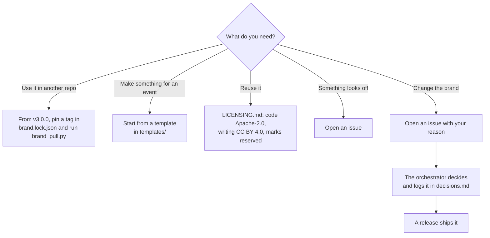

# Contributing

**Precedence.** `CLAUDE.md` wins over this page; fix this page if they disagree.

| Step | Where |
|---|---|
| An idea | [Discussions: Ideas](https://github.com/Colorado-Startups/brand/discussions/categories/ideas) |
| A bug | [Issue forms](https://github.com/Colorado-Startups/brand/issues/new/choose) |
| A pull request | Run `bash tools/verify.sh`; sign off each commit (`git commit -s`, the DCO); Paul approves outside PRs (decision 34) |

Claude makes every logo, mark, template and asset (decision 5). You use the brand, report what looks wrong, and suggest changes by issue or pull request. Paul approves every outside pull request before it merges (decision 34).

## A good issue

- **Where:** the URL, file path or screenshot.
- **What:** what you saw and what you expected.
- **Rule:** the rubric rule it breaks, if one fits (`governance/audit/rubric.yaml`: `logo-variant`, `palette`, `type`, `voice-lint`, `clear-space`, `contrast`, `naming`, `register`).

## Pull requests

Typo and docs fixes are welcome as pull requests. Anything that changes how the brand looks or sounds starts as an issue, because the orchestrator makes and logs that call.

## Outposts and volunteers

Keep the name as the lockup writes it ("Colorado Startups · Golden Outpost") and start from a template. Never redraw the logo, recolor it or pick new fonts. Ask in an issue and Claude makes what you need.

## Never

- Ship anything that borrows a name, emblem, script or picture from a game or film franchise.
- Show a keeper without saying it is an AI agent.
