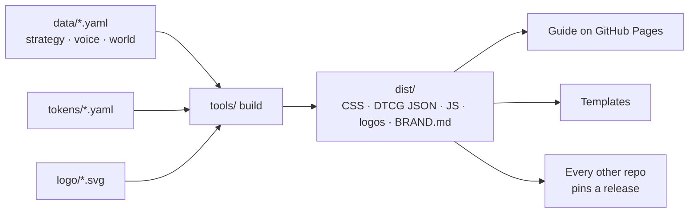

# Colorado Startups brand

The open source of the Colorado Startups brand: strategy, voice, world, tokens, logos, art direction and templates. Colorado first, with the State of Colorado's palette, real Front Range landmarks, and an original mountain-forge twist.

| Need | Go to |
|---|---|
| See the brand | [The guide](https://colorado-startups.github.io/brand/) |
| See how healthy the repo is | [Quality, Speed, Consumption](https://colorado-startups.github.io/brand/quality/) · [Process](https://colorado-startups.github.io/brand/quality/process.html) |
| Use it in a repo | From `v3.0.0`: pin a release in `brand.lock.json`, pull with `tools/brand_pull.py`, commit the copies |
| Why something is the way it is | [`decisions.md`](decisions.md) |
| Contribute | [`CONTRIBUTING.md`](CONTRIBUTING.md) |
| Reuse it | Code: [Apache-2.0](LICENSE). Writing and data: [CC BY 4.0](LICENSES/CC-BY-4.0.txt). Name, marks and keepers: [`TRADEMARKS.md`](TRADEMARKS.md) |
