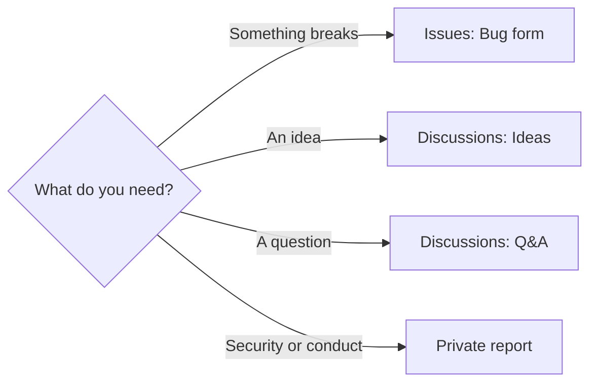

# Support

From Colorado-Startups/coloradostartups.org `SUPPORT.md` at b8d3a92 (Git Crafter v7.0.0).

| Need | Where |
|---|---|
| Report a bug | [Issues](https://github.com/Colorado-Startups/brand/issues/new/choose), the **Bug** form |
| Propose an idea or a feature | [Discussions: Ideas](https://github.com/Colorado-Startups/brand/discussions/categories/ideas) |
| Ask a question | [Discussions: Q&A](https://github.com/Colorado-Startups/brand/discussions/categories/q-a) |
| Report a security problem | [SECURITY.md](SECURITY.md), never a public issue |
| Report conduct | [CODE_OF_CONDUCT.md](CODE_OF_CONDUCT.md) |
| Contribute a change | [CONTRIBUTING.md](CONTRIBUTING.md) |
| See the scores and process maps | [Quality](https://colorado-startups.github.io/brand/quality/), [Process](https://colorado-startups.github.io/brand/quality/process.html) |
