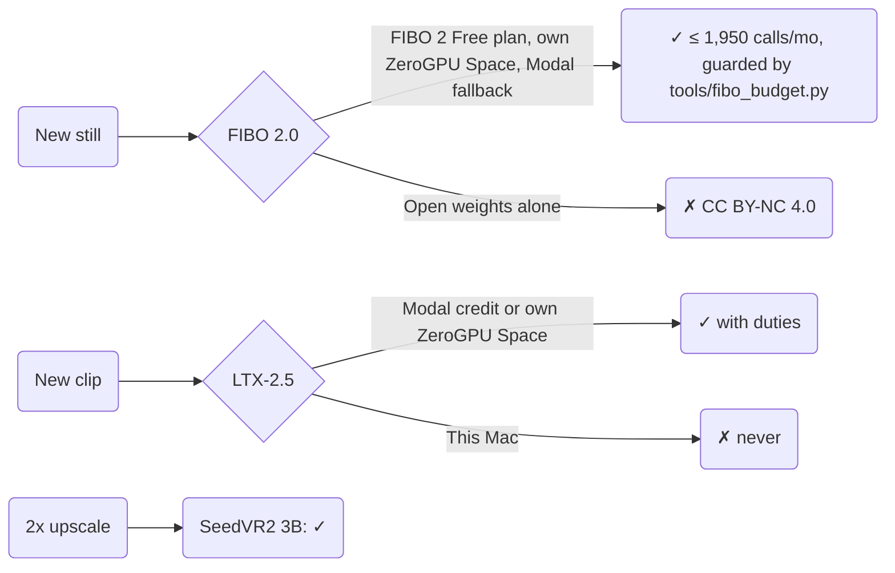

# Model licences for the brand's art

**Precedence.** `decisions.md` wins (decision 31 sets the lanes; decision 8 sets how model-made media are labelled). The licence text at each source wins over these summaries. A model with no row here is not used. This is a record, not legal advice.

## Register

| Model | Licence | Verdict | Duties |
|---|---|---|---|
| **FIBO 2.0** (Bria), `briaai/Fibo-2.0-dev`, `-edit-turbo` | Bria FIBO 2 Free plan: self-hosted, buyers under $2M revenue, 2,000 calls a month free, IP warranty on outputs. Card required; $0.04 per call above 2,000, never blocked (platform.bria.ai pricing, read 2026-11-13) | **✓ up to 1,950 calls a month** (decision 35; spend exception in the account overlay). Run `python3 tools/fibo_budget.py reserve N` before each batch. The open weights without the plan are CC BY-NC 4.0: ✗ | Keep Bria's attribution, watermark and metadata. Never train on outputs. Mark every picture AI-made by an industry standard (Bria's terms); we use IPTC `DigitalSourceType`. Feed in only images we hold the rights to: our own art and public-domain, CC0 or CC BY photos, never franchise art (decisions 38 and 44) |
| **LTX-2.5** (Lightricks), image-to-video and first-last-frame | LTX-2.x Community License (2026-08-11): commercial use free under $10M revenue, counted across companies under common control (§1.3, §1.6, §2.1) | **✓** The company is under the line (owner, 2026-11-02; confirmed yearly) | Label clips machine-generated (Att. A item 5). Keep watermarks and provenance (§6, item 19). Never train on outputs (item 18). No commercial fine-tune without a paid licence (§2.2(c)). Follow `art/motion.md` |
| **SeedVR2 3B** (ByteDance Seed), 2x upscale | Apache-2.0 (`ByteDance-Seed/SeedVR2-3B`, read 2026-11-02) | **✓** | An upscaled AI-made still stays AI-made |
| **Rive** (editor, CLI and runtimes), image motion for keepers and the hero (decision 37) | Rive Terms of Service, last updated 2026-05-20 (rive.app/docs/legal/terms-of-service, read 2026-11-15). Runtimes MIT: `rive-app/rive-wasm` and `rive-app/rive-runtime` (GitHub, read 2026-11-15); no runtime fees (rive.app/pricing, read 2026-11-15) | **✓ on Cadet**, one seat: $17 a seat a month, or $108 a seat a year paid upfront (rive.app/docs/account-admin/pricing.md, read 2026-11-16). Paul's yes on 2026-11-15 was to "$9 a month", so monthly or yearly upfront is an open billing question for him. Free exports play a Rive splash screen; Cadet's do not, and allow 500 publishes and pushes a month (rive.app/pricing). Enterprise is required only past $10M revenue (ToS C-6) | We own our files (ToS D-4); Rive holds a licence to host and show them for the service only (D-5). Keep every file Private: Community files go out under CC BY 4.0 and cannot be taken back (D-6). Upload only what we hold the rights to (D-2): our own released art, never franchise art. Rive's AI features: no output passed off as wholly human-made, none used to train another model (§8). Keepers are restyled before any rigging (decision 64). Follow `art/motion.md` |
| **Anima** (CircleStone Labs) | Model use non-commercial; §2(e) lets the site use its images | Shipped website art stays; nothing new renders | Keep the AI-made label |

## Lanes ($0 only)

| Lane | Status | Guard |
|---|---|---|
| Own ZeroGPU Space `paul-co-startups/brand-fibo` (HF PRO) | ✓ primary FIBO lane (decision 41): text to image on Fibo-2.0-dev, edits by Bria's method (its VGL step, then Fibo-2.0-edit-turbo). Source `art/render/space/`; client `python3 art/render/fibo_cards.py <entry>` | PRO's 40 daily minutes (`xlarge` spends them at 2x), then the included $2.00 credit until it reads $0, then stop; recharge stays off (huggingface.co/settings/billing, read 2026-11-13). The VGL step uses Bria's third-party demo Space and receives each source photo. Read minutes and credit before and after a batch |
| Public Space `Lightricks/LTX-2.5` (LTX-2.5 distilled, image to video) | ✓ the clip lane (decision 61): `R art/render/ltx_clips.py render <clip> --seed N`. Encodes and frame checks run on the own CPU Space `paul-co-startups/brand-clips` (`art/render/clip-space/`, free tier) | PRO's daily ZeroGPU quota, about 0.8 minutes a call; read minutes and credit before and after each call |
| Own ZeroGPU Space `paul-co-startups/brand-ltx` (`art/render/ltx-space/`, private; LTX-2.5 distilled plus `Lightricks/LTX-2.5-22b-LoRA-Cinemagraph`) | ✓ the still-camera clip lane (decision 62): `R art/render/ltx_clips.py cinemagraph <clip> --seed N`. Both repos are gated; Paul accepted both licences on 2026-11-15. `xlarge`, so 2x quota | PRO's ZeroGPU quota, about 0.7 minutes a call; read minutes and credit before and after each call; stop past 35 of 40 minutes |
| LTX Studio and the LTX Developer Console | ✗ Studio's Free and Lite plans carry a personal-use licence and Free is watermarked; the Console has only paid credits (read 2026-11-15) | none |
| Modal, included monthly credit | ✓ fallback lane: `modal run art/render/fibo_cards.py::<entry>` | spend limit = credit |
| Public demo Spaces | ✓ HF PRO is active on `paul-co-startups` (`hf_whoami`, read 2026-11-13). The org `colorado-startups` is on HF's free plan, which hosts no ZeroGPU Space | PRO's daily ZeroGPU quota |
| HF Jobs | included credit only | balance read before and after |
| Bria's hosted API and website | Up to $6.00 of the $7.00 free credit (decision 42): $0.032 per FIBO generation or edit (bria.ai/pricing); Bria bills the card automatically at $0 (platform.bria.ai, read 2026-11-14), so `tools/fibo_budget.py reserve-bria N` refuses past $6.00. Not wired yet | `art/bria-credit.yaml`; read Bria's Credits page before and after |
| This Mac | ✗ no video, no GPU | `rules/compute.md` |

Each render batch runs after one yes in chat with its estimate, or under the finish plan's standing yes of at most 60 FIBO calls (decision 48).

## Not used

No SVG or hand-drawn artwork ships (decision 37); data charts are not artwork.

| Model | Why |
|---|---|
| MiniMax H3 | Its licence excludes the United States |
| Qwen-Image, Qwen-Image Edit | FIBO 2.0 makes the edits |
| Z-Image, Krea 2 | Not used (Paul, 2026-10-18) |

## Duties before anything ships

| Duty | Status |
|---|---|
| AI-made label in every model-made image's and clip's metadata (decision 46) | Rule |
| Provenance and watermarks kept | Rule |
| No training on outputs | Rule |
| Revenue under both lines, confirmed yearly | Due 2027-11-02 |
| Paul accepts the Free plan and adds the card on platform.bria.ai; accepts the `briaai/Fibo-2.0-dev` gate | Done (Paul, 2026-11-13) |
