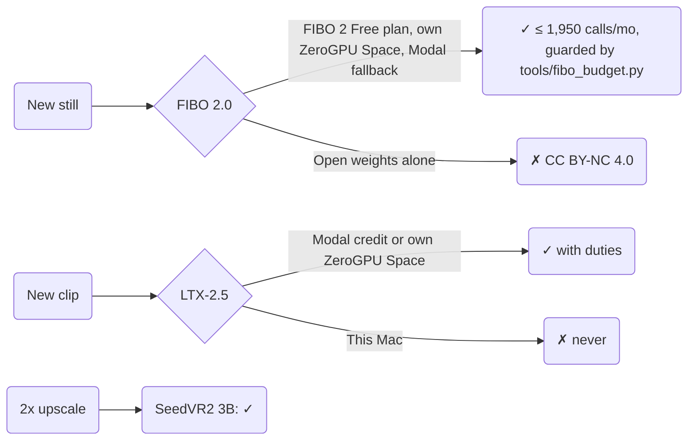

# Model licences for the brand's art

**Precedence.** `decisions.md` wins (decision 31 sets the lanes; decision 8 sets how model-made media are labelled). The licence text at each source wins over these summaries. A model with no row here is not used. This is a record, not legal advice.

## Register

| Model | Licence | Verdict | Duties |
|---|---|---|---|
| **FIBO 2.0** (Bria), `briaai/Fibo-2.0-dev`, `-edit-turbo` | Bria FIBO 2 Free plan: self-hosted, buyers under $2M revenue, 2,000 calls a month free, IP warranty on outputs. Card required; $0.04 per call above 2,000, never blocked (platform.bria.ai pricing, read 2026-11-13) | **✓ up to 1,950 calls a month** (decision 35; spend exception in the account overlay). Run `python3 tools/fibo_budget.py reserve N` before each batch. The open weights without the plan are CC BY-NC 4.0: ✗ | Keep Bria's attribution, watermark and metadata. Never train on outputs. Label every picture AI-made. Feed in only the Hall's own art |
| **LTX-2.5** (Lightricks), image-to-video and first-last-frame | LTX-2.x Community License (2026-08-11): commercial use free under $10M revenue, counted across companies under common control (§1.3, §1.6, §2.1) | **✓** The company is under the line (owner, 2026-11-02; confirmed yearly) | Label clips machine-generated (Att. A item 5). Keep watermarks and provenance (§6, item 19). Never train on outputs (item 18). No commercial fine-tune without a paid licence (§2.2(c)). Real places shown as they are. Follow `art/motion.md` |
| **SeedVR2 3B** (ByteDance Seed), 2x upscale | Apache-2.0 (`ByteDance-Seed/SeedVR2-3B`, read 2026-11-02) | **✓** | An upscaled AI-made still stays AI-made |
| **Anima** (CircleStone Labs) | Model use non-commercial; §2(e) lets the site use its images | Shipped website art stays; nothing new renders | Keep the AI-made label |

## Lanes ($0 only)

| Lane | Status | Guard |
|---|---|---|
| Own ZeroGPU Space `paul-co-startups/brand-fibo` (HF PRO) | ✓ primary FIBO lane (decision 41): text to image on Fibo-2.0-dev, edits by Bria's method (its VGL step, then Fibo-2.0-edit-turbo). Source `art/render/space/`; client `python3 art/render/fibo_cards.py <entry>` | PRO's 40 daily minutes, then the included $2 credit with automatic recharge off (huggingface.co/settings/billing, read 2026-11-13). Read both before and after a batch |
| Modal, included monthly credit | ✓ fallback lane: `modal run art/render/fibo_cards.py::<entry>` | spend limit = credit |
| Public demo Spaces | ✓ HF PRO is active on `paul-co-startups` (`hf_whoami`, read 2026-11-13). The org `colorado-startups` is on HF's free plan, which hosts no ZeroGPU Space | PRO's daily ZeroGPU quota |
| HF Jobs | included credit only | balance read before and after |
| Bria's hosted API and website | ✗ waits for Paul's billing call. Paul, 2026-11-13: free for companies under $2M revenue. But his platform.bria.ai account reads "7.00 free credits remaining (Pay-as-you-go)", and its Credits tab says "When credits run out, PAYG continues automatically" on the card on file (read 2026-11-13). A one-time credit with card billing after it is not a free tier. Attribution calls are not generation: they run under the FIBO 2 Free self-hosted licence, and Usage read $0.00 and 0 billable units this cycle after every one so far (read 2026-11-14) | none yet, so hosted generation is not used |
| This Mac | ✗ no video, no GPU | `rules/compute.md` |

Each render batch runs after one yes in chat with its estimate.

## Not used

No SVG or hand-drawn artwork ships (decision 37); data charts are not artwork.

| Model | Why |
|---|---|
| MiniMax H3 | Its licence excludes the United States |
| Qwen-Image, Qwen-Image Edit | FIBO 2.0 makes the edits |
| Z-Image, Krea 2 | Not used (Paul, 2026-10-18) |
| Comfy Cloud Bria nodes | Superseded by decision 31 |

## Duties before anything ships

| Duty | Status |
|---|---|
| AI-made label on every model-made image and clip | Rule |
| Provenance and watermarks kept | Rule |
| No training on outputs | Rule |
| Revenue under both lines, confirmed yearly | Due 2027-11-02 |
| Paul accepts the Free plan and adds the card on platform.bria.ai; accepts the `briaai/Fibo-2.0-dev` gate | Done (Paul, 2026-11-13) |
