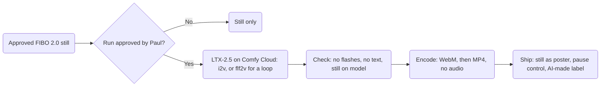

# Motion: LTX-2.5 rules for the Hall's clips

*S7, 2026-11-02.*

**Precedence.** `decisions.md` wins over this file: decision 14 sets the video route and the site-video limits, and decision 8 sets the AI-made label and provenance. `art/LICENSES.md` wins on which route is allowed. `~/.claude/rules/compute.md` wins on run tiers and spend. `art/DIRECTION.md` wins on the look. If any of them disagree with this file, fix this file in the same session.

**Where these rules come from.** The website's `art/DIRECTION.md` gained a Motion section in commit `13c6b52` (website decision 91), and a seventh rule, the AI-made label, in `e628748`. The merge commit `b1378dd`, part of PR #288 (merged as `88a57e5`), dropped that section. Rules 1 to 7 below restore it. Rules 8 to 12 add the LTX-2.5 settings and the web delivery rules from the research digest.

## At a glance



## The rules

1. **Animate only approved stills.** Every clip starts from an approved FIBO 2.0 still, through `video_ltx2_5_i2v`. A loop uses `video_ltx2_5_flf2v` with the same frame first and last. Text-to-video never ships.
2. **Ambient motion only.** Lantern glow rising and falling, drifting embers, turning gears, aspen leaves, creek water, slow clouds, a keeper's small wave. The camera holds still or drifts slowly. No cuts, and no multi-shot.
3. **Silent.** Clips play muted and ship with no audio track. Any clip with speech needs captions (WCAG 1.2.2).
4. **The still comes first.** The approved still is the poster frame. Under `prefers-reduced-motion: reduce` the still shows and the clip never loads.
5. **The reader can stop it.** Anything that moves for more than 5 seconds gets a visible pause control (WCAG 2.2.2). A loop keeps moving, so every loop gets one, whatever its length.
6. **No flashing.** Nothing flashes more than three times in any one second (WCAG 2.3.1). Lantern light rises and falls softly; it never strobes.
7. **Labeled as AI-made.** Every clip shows an "AI-made" label, and no watermark or provenance data is ever stripped (LTX-2.x license, Attachment A, items 5 and 19).
8. **One prompt paragraph.** Write one present-tense paragraph of 4 to 8 sentences about what moves, how it moves and what the camera does (LTX prompting guide, via the research digest). Use plain words and the Hall's vocabulary, with no names (`art/DIRECTION.md`, No borrowed pictures).
9. **Settings.** CFG about 4 or less (LTX prompting guide). The distilled checkpoint runs at CFG 1 (LTX-2.5 model card). Set `generate_audio: false`, because LTX-2.5 makes audio by default (research digest). Set the frame count by hand; leave the duration predictor off.
10. **Size and length.** Muted loops of 10 s or less, 720p at 24 fps, under about 1 MB (decision 14; the size is a goal).
11. **Delivery.** `autoplay muted loop playsinline`, WebM first, then MP4, the still as poster, and `preload="none"` or `"metadata"` (web.dev, "Replace animated GIFs with video").
12. **Same rules as the stills.** No text, runes or weapons. The same palette, light, composition and real-places rules (`art/DIRECTION.md`).

## Frame and size math

LTX-2.5 needs a frame count where `frames % 8 == 1`, and a width and height that divide by 32 (LTX-2.5 model card, "Constraints", read 2026-11-02). The numbers below are computed here from those two rules.

| Need | Setting | Why |
|---|---|---|
| 720p frame | Render 1280 × 736, crop 8 px from the top and the bottom to 1280 × 720 | 720 does not divide by 32; 736 is the next size that does |
| A loop of 10 s or less | 233 frames, 9.7 s at 24 fps | 241 frames, the next valid count, runs 10.04 s |
| A loop that repeats cleanly | Drop the last frame when encoding: 232 frames | In a first-and-last-frame loop the last frame repeats the first |
| A clip that plays once and stops | 113 frames or fewer, 4.7 s at 24 fps | It stops within 5 s, so it needs no pause control (WCAG 2.2.2) |
| Under about 1 MB (a goal) | About 800 kbit/s on average for a 9.7 s clip | 1 MB is 8,000 kbit; 8,000 ÷ 9.7 s is about 825 kbit/s |

## A sample prompt

For the home hero's loop, from its approved still:

> The great hall stays still as warm lantern light slowly rises and falls across the carved granite arches. Small embers drift upward from the hearth on the right and fade before they reach the beams. The molten-gold channel in the floor glows a little brighter, then softer, like slow breathing. The founders at the long table lean in and nod as they talk, with small, natural movements. The long banners sway gently in a light draft. The camera holds still at eye level, with no cuts.

## Encoding

Encoding is a light step; generating video never runs on this Mac (`~/.claude/rules/compute.md`). These are starting values. Raise the CRF number until the clip meets the 1 MB goal, then check it by eye.

```sh
# WebM (VP9), no audio, cropped to 1280 x 720
ffmpeg -i ltx-output.mp4 -vf "crop=1280:720:0:8" -frames:v 232 -an \
  -c:v libvpx-vp9 -b:v 0 -crf 40 -row-mt 1 -map_metadata 0 hall.webm
# MP4 (H.264), no audio, for browsers without WebM
ffmpeg -i ltx-output.mp4 -vf "crop=1280:720:0:8" -frames:v 232 -an \
  -c:v libx264 -profile:v high -pix_fmt yuv420p -crf 28 \
  -movflags +faststart -map_metadata 0 hall.mp4
```

**Provenance beats the size goal.** Check the first LTX-2.5 output for embedded provenance: a content-credentials manifest, metadata tags or a watermark. If it carries any, the shipped files must carry it too. If an encode drops it, ship a format that keeps it, and meet the size goal second (LTX-2.x license §6; Attachment A, item 19).

## Markup

The website builds the component (W3). This sketch shows the rules in place. The still stays in the page as the text alternative, and the clip sits over it.

```html
<figure class="hall-clip" data-clip>
  
  <video muted loop playsinline preload="none" poster="hall.webp" aria-hidden="true" hidden>
    <source data-src="hall.webm" type="video/webm">
    <source data-src="hall.mp4" type="video/mp4">
  </video>
  <button type="button" class="hall-clip__pause" aria-pressed="false" hidden>Pause motion</button>
  <figcaption class="hall-clip__label">AI-made</figcaption>
</figure>
<script>
  // The clip loads only when the reader has no reduced-motion preference (rule 4).
  if (matchMedia('(prefers-reduced-motion: no-preference)').matches) {
    for (const fig of document.querySelectorAll('[data-clip]')) {
      const video = fig.querySelector('video');
      const button = fig.querySelector('button');
      for (const s of video.querySelectorAll('source')) s.src = s.dataset.src;
      video.autoplay = true;
      video.load();
      video.hidden = false;
      button.hidden = false;
      button.addEventListener('click', () => {
        const paused = button.getAttribute('aria-pressed') !== 'true';
        if (paused) video.pause(); else video.play();
        button.setAttribute('aria-pressed', String(paused));
      });
    }
  }
</script>
```

```css
.hall-clip { position: relative; }
.hall-clip video { position: absolute; inset: 0; width: 100%; height: 100%; object-fit: cover; }
.hall-clip__pause { position: absolute; right: 0.5rem; bottom: 0.5rem; min-width: 24px; min-height: 24px; }
```

The pause button is a real button, reachable by keyboard, at least 24 by 24 CSS pixels (WCAG 2.5.8). Its label stays "Pause motion"; `aria-pressed` says whether motion is paused.

## Runs and records

- **Lane.** Clips run on the $0 lanes in `art/LICENSES.md` (decision 31). Each batch waits for Paul's yes in chat, with the lane's balance read before and after (`~/.claude/rules/compute.md`).
- **Never on this Mac.** LTX-2.5 needs an NVIDIA GPU with at least 32 GB of memory (research digest), and the house rule bans local video.
- **Queue.** Every planned clip is in `art/render-queue.yaml`, blocked on Paul's queue items 1 and 2.
- **Record.** Each clip keeps a provenance record beside it. It names the source still, the model, the template, the prompt, the seed, the frame count and the CFG. It also records the date, who approved the run, and the credit balance before and after.
- **Refine and matte.** The LTX-2.5 IC-LoRAs for refining detail or cutting an alpha matte run under the same rules and the same license (`art/LICENSES.md`).

## Sources

Read 2026-11-02.

| Source | Used for |
|---|---|
| The website's `art/DIRECTION.md` at `13c6b52` and `e628748`; the merge `b1378dd` | Rules 1 to 7, and where they were lost |
| [LTX-2.5 model card](https://huggingface.co/Lightricks/LTX-2.5) | Frame and size constraints; CFG 1 on the distilled checkpoint |
| [LTX-2 prompting guide](https://docs.ltx.io/open-source-model/usage-guides/prompting-guide), via the research digest | One present-tense paragraph of 4 to 8 sentences; CFG about 4 or less; audio on by default |
| [LTX-2.x Community License](https://github.com/Lightricks/LTX-2/blob/main/LICENSE-2_x) | Labels, watermarks and provenance (§6; Attachment A, items 5 and 19) |
| [WCAG 2.2](https://www.w3.org/TR/WCAG22/) | 1.2.2 captions, 2.2.2 pause, 2.3.1 three flashes, 2.5.8 target size |
| [web.dev, "Replace animated GIFs with video"](https://web.dev/articles/replace-gifs-with-videos) | `autoplay muted loop playsinline`, WebM first, poster, `preload` |
