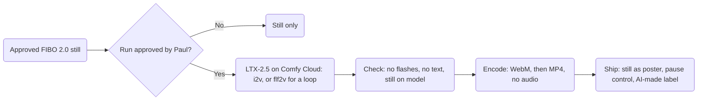

# Motion: LTX-2.5 rules for the Hall's clips: At a glance

Part 1 of 4 of [`motion.md`](../motion.md).

## At a glance

## The rules

1. **Animate only approved stills.** Every clip starts from an approved FIBO 2.0 still, through `video_ltx2_5_i2v`. A loop uses `video_ltx2_5_flf2v` with the same frame first and last. Text-to-video never ships.
2. **Ambient motion only.** Lantern glow rising and falling, drifting embers, turning gears, aspen leaves, creek water, slow clouds, a keeper's small wave. The camera holds still or drifts slowly. No cuts, and no multi-shot.
3. **Silent.** Clips play muted and ship with no audio track. Any clip with speech needs captions (WCAG 1.2.2).
4. **The still comes first.** The approved still is the poster frame. Under `prefers-reduced-motion: reduce` the still shows and the clip never loads.
5. **The reader can stop it.** Anything that moves for more than 5 seconds gets a visible pause control (WCAG 2.2.2). A loop keeps moving, so every loop gets one, whatever its length.
6. **No flashing.** Nothing flashes more than three times in any one second (WCAG 2.3.1). Lantern light rises and falls softly; it never strobes.
7. **Labeled as AI-made.** Every clip shows an "AI-made" label, and no watermark or provenance data is ever stripped (LTX-2.x license, Attachment A, items 5 and 19).
8. **One prompt paragraph.** Write one present-tense paragraph of 4 to 8 sentences about what moves, how it moves and what the camera does (LTX prompting guide, via the research digest). Use plain words and the Hall's vocabulary, with no names (`art/DIRECTION.md`, No borrowed pictures).
9. **Settings.** CFG about 4 or less (LTX prompting guide). The distilled checkpoint runs at CFG 1 (LTX-2.5 model card). Set `generate_audio: false`, because LTX-2.5 makes audio by default (research digest). Set the frame count by hand; leave the duration predictor off.
10. **Size and length.** Muted loops of 10 s or less, 720p at 24 fps, under about 1 MB (decision 14; the size is a goal).
11. **Delivery.** `autoplay muted loop playsinline`, WebM first, then MP4, the still as poster, and `preload="none"` or `"metadata"` (web.dev, "Replace animated GIFs with video").
12. **Same rules as the stills.** No text, runes or weapons. The same palette, light, composition and real-places rules (`art/DIRECTION.md`).
