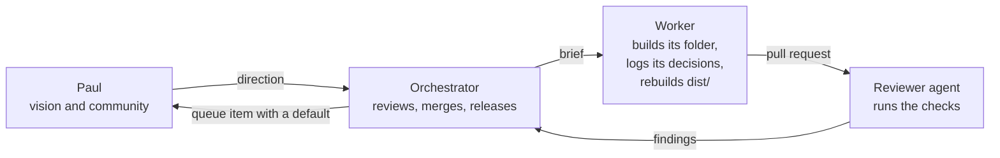

# Owners

**Precedence.** `CLAUDE.md` (its folder table), `decisions.md`, the approved plan's queue and `~/.claude/rules/delegation.md` win over this page. If they disagree, fix this page in the same session.

## Who does what

| Role | Who | Owns | Never |
|---|---|---|---|
| Vision and community | Paul | Where the brand is going, the community, and Paul's queue (below) | Writes code, picks colors or reviews pull requests (decision 4; `delegation.md`) |
| Orchestrator | The Claude session that started the overhaul | `README.md`, `CLAUDE.md`, `AGENTS.md`, `baseline/`; the review and merge of every pull request; tags, releases, the guide and the Artifact; picks among concept explorations (decision 21) | Asks Paul for a design call; merges without a passing review |
| Every session | The orchestrator and every worker | Appends its own decisions to `decisions.md` and rebuilds `dist/` with `tools/` in its own pull request, rebasing on conflict (decision 21) | Edits or renumbers another session's decision |
| Workers | One Claude session per folder row in `CLAUDE.md` | Its folders, until its pull request merges | Edits a file outside its folders, other than `decisions.md` and `dist/`; merges |
| Reviewers | Reviewer agents the orchestrator starts | A review of each head commit: it runs the checks itself, lists the commands it ran, and reports blocking findings | Merges, or edits the branch it reviews |

## Rights

Code is Apache-2.0, writing and data are CC BY 4.0, and the name, marks and keepers are reserved (`LICENSING.md`, decision 32). Anything that ships publicly still passes the website's franchise gate and trademark law.

## Sub-brands

The brand sets no fixed relationship rule for Photon Mountain, Space Peak, Fusion Canyon or any other sub-brand (decision 21). The orchestrator decides each relationship case by case and logs it.

## After a worker's pull request merges

Its folder passes to the orchestrator. A later change to that folder gets a new worker session with the same folder row, so two sessions never write one file, apart from the appends to `decisions.md` and the `dist/` rebuilds that every session makes.

## How a pull request merges

Only the orchestrator merges, and every pull request gets its review (house rule). It merges when the head commit has: the bash guard's `--status` passing, every CI check green (S10's drift check blocks a stale `dist/`), `bash tools/verify.sh` green after the last change, and a reviewer's shell review with no blocking finding. It merges with `--match-head-commit` and the reviewed SHA (`delegation.md`, "Who merges").

## Paul's queue

Nothing waits on these; each has a default. The orchestrator lists them once, with their defaults, when nothing else can move. Items 1 to 9 restate the approved plan's queue, which wins.

| # | Item | Default if untouched |
|---|---|---|
| 1 | Send Comfy the commercial-use request drafted at the Comfy request (dropped by decision 31) | No FIBO renders; the shipped art is regraded |
| 2 | Set a Comfy Cloud credit budget for brand renders and video | No new renders or video |
| 3 | Upload the new LinkedIn logo and cover, the Slack icon and the Kit template; paste the new email signature | The files and one-page steps wait in `templates/` |
| 4 | Sign in to Canva or Figma, if the connector is not on the Colorado Startups account | The kit ships as files |
| 5 | Optional: send the community survey (`governance/survey.md`) as Paul | Skipped; survey KPIs stay "not measured yet" |
| 6 | File a trademark for the final mark (costs money) | Not now |
| 7 | No longer waits on Paul. The orchestrator deletes the interim Worker `colorado-startups-brand` and its placeholder at `brand.coloradostartups.org` (decision 27) | The placeholder stays up until the orchestrator deletes it |
| 8 | Confirm once a year that revenue stays under the FIBO 2 Free plan's and LTX-2.5 licence's lines (`art/LICENSES.md`) | No renders |
| 9 | Decide on the Anima-made art already on the website | The art stays until FIBO 2.0 replacements render, then it is swapped out |
| 10 | Proposed by S11: read access to Slack analytics, Kit and the Luma calendar, if a KPI reading needs a sign-in (`data/kpis.yaml`) | Those KPIs stay `current: null` |

Standing items from `delegation.md` that reach Paul the same way: spending money, sign-ins and new keys, anything needing an administrator or another Mac account, sending anything as Paul, deleting for good outside git, running a deploy script by hand, new scheduled work, and any command the bash guard blocks without naming a fix.
