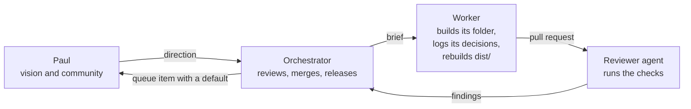

# Owners: Who does what

Part 1 of 2 of [`owners.md`](../owners.md).

## Who does what

| Role | Who | Owns | Never |
|---|---|---|---|
| Vision and community | Paul | Where the brand is going, the community, and Paul's queue (below) | Writes code, picks colors or reviews pull requests (decision 4; `delegation.md`) |
| Orchestrator | The Claude session that started the overhaul | `README.md`, `CLAUDE.md`, `AGENTS.md`, `baseline/`; the review and merge of every pull request; tags, releases, the guide and the Artifact; picks among concept explorations (decision 21) | Asks Paul for a design call; merges without a passing review |
| Every session | The orchestrator and every worker | Appends its own decisions to `decisions.md` and rebuilds `dist/` with `tools/` in its own pull request, rebasing on conflict (decision 21) | Edits or renumbers another session's decision |
| Workers | One Claude session per folder row in `CLAUDE.md` | Its folders, until its pull request merges | Edits a file outside its folders, other than `decisions.md` and `dist/`; merges |
| Reviewers | Reviewer agents the orchestrator starts | A review of each head commit: it runs the checks itself, lists the commands it ran, and reports blocking findings | Merges, or edits the branch it reviews |

## Rights

Code is Apache-2.0, writing and data are CC BY 4.0, and the name, marks and keepers are reserved (`LICENSING.md`, decision 32). Anything that ships publicly still passes the website's franchise gate and trademark law.

## Sub-brands

The brand sets no fixed relationship rule for Photon Mountain, Space Peak, Fusion Canyon or any other sub-brand (decision 21). The orchestrator decides each relationship case by case and logs it.

## After a worker's pull request merges

Its folder passes to the orchestrator. A later change to that folder gets a new worker session with the same folder row, so two sessions never write one file, apart from the appends to `decisions.md` and the `dist/` rebuilds that every session makes.

## How a pull request merges

Only the orchestrator merges, and every pull request gets its review (house rule). It merges when the head commit has: the bash guard's `--status` passing, every CI check green (S10's drift check blocks a stale `dist/`), `bash tools/verify.sh` green after the last change, and a reviewer's shell review with no blocking finding. It merges with `--match-head-commit` and the reviewed SHA (`delegation.md`, "Who merges").
