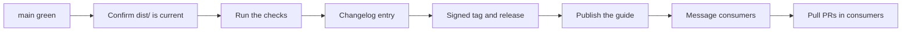

# Releases: Release steps

Part 2 of 3 of [`releases.md`](../releases.md).

## Release steps



1. **Freeze.** Every pull request for the release is merged and CI is green on `main`.
2. **Confirm `dist/` is current.** Every pull request that changes a source rebuilds `dist/` itself, and S10's drift check blocks a stale one (decision 21). On a release branch, run S10's build (its command will be in `tools/README.md`); it must leave no diff. If it does, commit the rebuilt `dist/` there.
3. **Run the checks.** `bash tools/verify.sh` must pass. Once S10 ships them, `python3 -I tools/brand_pull.py --self-test` must pass too, and a dry-run pin into a scratch folder must match the `dist/` checksums. The guide has no word or control limit to check (decision 21).
4. **Write the changelog entry** (format below). It points to the decisions each session appended to `decisions.md`; it does not restate them. Then merge the release branch under the usual review rule.
5. **Tag and release.** `git tag -s vX.Y.Z -m "vX.Y.Z"` on the merge commit, push the tag, then `gh release create vX.Y.Z --notes-file <the entry>`. Attach the checksums that `brand_pull.py` checks.
6. **Publish the guide.** `pages.yml` deploys on merge to `main` (decision 28). Load `colorado-startups.github.io/brand/` and confirm the version it shows.
7. **Message consumers.** Send each consumer's session the tag and the sha256 of every file it pulls.
8. **Open pull PRs in consumers.** In each consumer below, bump `brand.lock.json` to the new tag, pull the files with `brand_pull.py` (it fetches through `gh`, so no key is handled), commit the copies, and open a pull request that quotes the changelog entry. The consumer's CI runs `brand_pull.py --check` (decision 10). A major release lists every "Consumers must" line. Each consumer's own orchestrator merges.

## Consumers

| Consumer | How it takes a release | Session that wires it |
|---|---|---|
| `coloradostartups-site` | `brand.lock.json` and `scripts/brand_pull.py` | W1 |
| `.github`, `.github-private` (org profiles) | Copies its images and links from a tag | S16 |
| `photon-mountain`, `space-peak` | Whatever relationship the orchestrator sets for each; the brand has no fixed sub-brand rule (decision 21) | S17 |
| LinkedIn kit, `Volunteers/Roles`, `AI Initiatives/Pages` (local folders) | A Claude session copies from the tag | S15 |

## Changelog format

The orchestrator keeps `CHANGELOG.md` at the repo root in the [Keep a Changelog 1.1.0](https://keepachangelog.com/en/1.1.0/) shape: newest first, an `Unreleased` section on top, ISO dates. Each line names its pull request and any decision it carries out. Majors add a "Consumers must" section.

```markdown
## [Unreleased]
