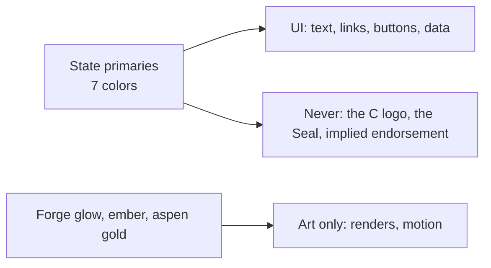

# The State of Colorado palette

**Precedence.** `decisions.md` wins (decision 29). Data: [`state.yaml`](state.yaml). Sources: the State's live brand pages, read 2026-11-15 (decision 56): The Elements (the seven primaries, unchanged from the 2024 guide), the Digital Guidelines 1.8 Color System and Typography pages (2025-04-01), and Inclusive Branding.

| Color | Hex | On white | On black |
|---|---|---|---|
| Red | `#C3002F` | 6.25 ✓ text | 3.36 large only |
| Blue | `#001970` | 15.29 ✓ text | 1.37 ✗ |
| Purple | `#6D3A5D` | 8.70 ✓ text | 2.41 ✗ |
| Tree Green | `#245D38` | 7.78 ✓ text | 2.70 ✗ |
| Yellow | `#FFD100` | 1.46 ✗ | 14.37 ✓ text |
| Left Mountain Green | `#7A853B` | 4.00 large only | 5.25 ✓ text |
| Right Mountain Teal | `#35647E` | 6.41 ✓ text | 3.28 large only |
Contrast is WCAG 2.2: 4.5 for text, 3 for large text and UI parts. The ratios match the State's own digital color table.

| Rule | Why |
|---|---|
| Blue, Purple, Tree Green, Red and Right Mountain Teal carry text on white | ≥ 6.25:1 |
| Yellow never carries text on white; it sits behind black or Blue text | 1.46:1 on white |
| Left Mountain Green is for large text or UI parts on white, or black text on it | 4.00:1 |
| Type: Museo Slab 500 for headlines, Trebuchet MS for body and live web text | The Elements |
| Web body font: Atkinson Hyperlegible (OFL), newly approved | Inclusive Branding; Digital Guidelines 1.8, Typography |
| Web steps: 22 USWDS tokens around the primaries (`primary-darker #001049` to `accent-warm-darker #DFA902`), as `--co-web-*` | Digital Guidelines 1.8, Color System |
| Web text: primary-dark or primary-darker on a subtly off-white ground; dark mode only as an opt-in | Digital Guidelines 1.8, Color System |
