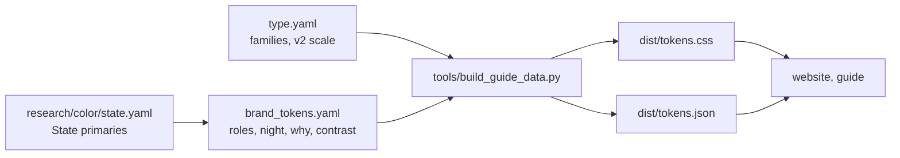

# tokens

The design tokens: one source, two built files. Decision 51.

| File | Holds |
|---|---|
| `brand_tokens.yaml` | 36 color roles, each with a `light` value, an optional `night` value and a one-line `why`; the 12 old-name aliases; space, radius, line, size and shadow; the recorded contrast ratios (`contrast`, `contrast-night`) |
| `type.yaml` | The two families with their licences, and the v2 type scale carried over unchanged. No new scale (decision 49) |

| Rule | Detail |
|---|---|
| Names | Every role, space, radius, line and size name and value is v2's (`baseline/v2/brand_tokens.yaml`). Only color values changed, so the website's code keeps working |
| Colors | The State palette leads (decision 29). `"@Blue"` is the State primary of that name in `research/color/state.yaml`; any other value is a tint or shade of one primary, named in its `why`. Forge glow and gold stay in the art |
| Night | A role with no `night` value keeps its light value. The night set is the dark theme of `guide/public/guide.css` |
| Contrast | WCAG 2.2 AA: 4.5 for text, 3 for large text and UI parts. The builder recomputes every recorded ratio and fails if one is wrong or under its `min` |
| Change | Edit the yaml, run `python3 tools/build_guide_data.py`, commit `dist/` in the same PR. `verify.sh` runs `--check` and blocks a stale `dist/` |
| Left out | v2's `texture` limits: they bound art tiles the website draws itself, and art is not a token |

| Built file | Names |
|---|---|
| `dist/tokens.css` | `--co-<state color>` (the seven primaries), `--c-<role>`, `--c-<old name>`, `--s-<n>`, `--r-<name>`, `--line-<name>`, `--size-<name>`, `--sh-<name>`, `--t-<name>`; a `prefers-color-scheme: dark` block and a `[data-theme="dark"]` block set the night values; `[data-theme="light"]` keeps light under a dark OS |
| `dist/tokens.json` | The same set in the Design Tokens format (DTCG 2025.10). Each night value is under `$extensions."org.coloradostartups.brand"`, with the contrast records |

Owner: S12.
