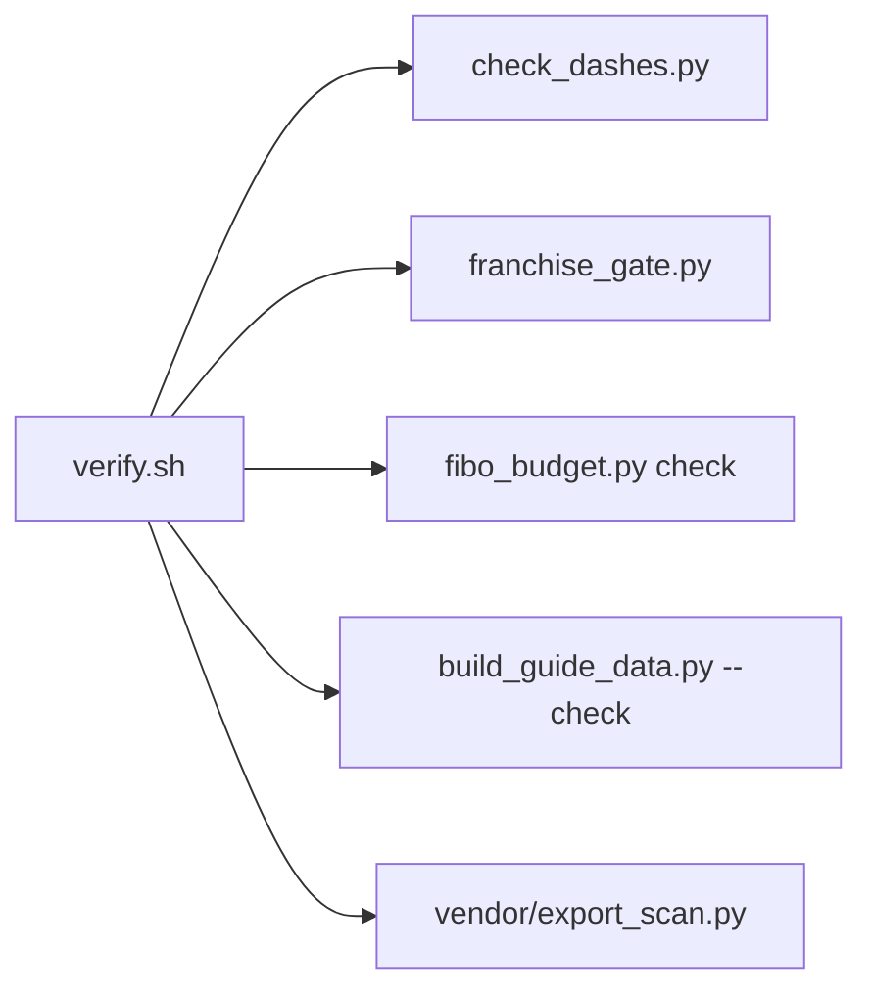

# tools

| File | Does | Exit |
|---|---|---|
| `verify.sh` | Runs every check below; CI runs it | 1 on any finding |
| `check_dashes.py` | No em dash or spaced en dash | 0 clean, 1 finding, 2 usage, 3 could not check |
| `franchise_gate.py` | No franchise name in `data/`, `dist/`, `guide/`, `templates/`, `logo/`; `--dir site` scans the built site. Joins the vendored rule and `data/words.yaml` `never`, and self-tests every sample there (decisions 30 and 49) | same |
| `fibo_budget.py` | FIBO call guard: `reserve N` refuses past 1,950 a month (decision 35) | same |
| `build_guide_data.py` | Builds `dist/brand.json` (the guide's data, from `data/`, `tokens/type.yaml`, `research/color/state.yaml` and `TRADEMARKS.md`), `dist/tokens.css` and `dist/tokens.json` (from `tokens/`, decision 50). `brand.json` lists every `dist/` file but itself with its sha256. Fails if a recorded contrast ratio is wrong or under its min. Needs PyYAML, so `verify.sh` runs `--check` and reports a missing PyYAML as a note | `--check`: 0 fresh, 1 stale or a token rule failed, 3 no PyYAML |
| `vendor/` | Byte copies from the website at `b8d3a92`: `export_scan.py` (leak scan) and the franchise rule | same |

Owner: S10. Every check ships a self-test.
