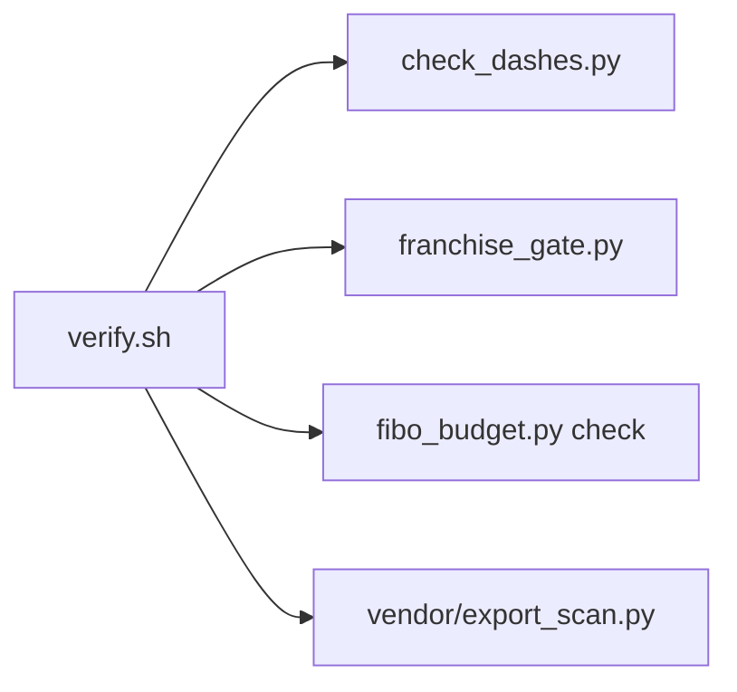

# tools

| File | Does | Exit |
|---|---|---|
| `verify.sh` | Runs every check below; CI runs it | 1 on any finding |
| `check_dashes.py` | No em dash or spaced en dash | 0 clean, 1 finding, 2 usage, 3 could not check |
| `franchise_gate.py` | No franchise name in `data/`, `dist/`, `guide/`, `templates/`, `logo/` (decision 30) | same |
| `fibo_budget.py` | FIBO call guard: `reserve N` refuses past 1,950 a month (decision 35) | same |
| `vendor/` | Byte copies from the website at `b8d3a92`: `export_scan.py` (leak scan) and the franchise rule | same |

Owner: S10. Every check ships a self-test.
